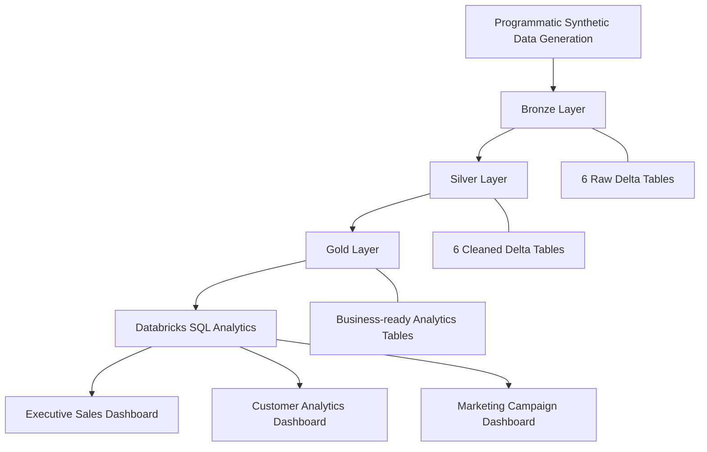

# Fashion Retail Analytics Lakehouse


An end-to-end retail analytics project built using **Databricks, PySpark, Delta Lake and SQL**, designed around a fictional Indian fashion retailer, NOVA THREADS.

The project demonstrates a Bronze-Silver-Gold lakehouse architecture, programmatic synthetic data generation, data transformation, business analytics and interactive dashboards.

## Project Overview

NOVA THREADS is a fictional fashion retail business operating through a website and mobile application across four major Indian cities.

This project simulates its retail data ecosystem and develops analytical datasets to support business decisions across sales, products, customers, inventory and marketing campaigns.

### Key Highlights

- Generated and processed approximately **850,000 records** across six synthetic datasets.
- Implemented Bronze, Silver and Gold data layers using Delta tables.
- Built PySpark transformation workflows with data quality and business-rule validations.
- Developed customer segmentation using RFM analysis.
- Created 10 analytical SQL queries using CTEs, window functions and aggregations.
- Built three interactive Databricks AI/BI dashboards.

## Technology Stack

| Technology | Usage |
|---|---|
| Databricks | Lakehouse development and analytics |
| PySpark | Data generation and ETL transformations |
| Delta Lake | Structured table storage |
| SQL | Business analytics and reporting |
| Python | Data generation and processing |
| Databricks AI/BI | Interactive dashboards |
| GitHub | Project version control and documentation |

## Architecture



## Data Overview

Six datasets were generated programmatically using Python and PySpark, with randomized but controlled combinations to simulate realistic retail activity.

| Dataset | Records |
|---|---:|
| Customers | 100,000 |
| Products | 10,000 |
| Inventory | 40,000 |
| Orders | 200,000 |
| Order Items | 499,765 |
| Marketing Campaigns | 200 |
| **Total** | **849,965** |

The simulated business operates across Mumbai, Pune, Delhi and Bengaluru.

## Lakehouse Implementation

### 1. Bronze Layer
- Generated synthetic datasets programmatically.
- Stored raw datasets as managed Delta tables.
- Maintained six source tables covering retail operations.

### 2. Silver Layer
- Standardised categorical values and text fields.
- Validated transaction amounts and business rules.
- Checked duplicates, missing values and invalid records.
- Verified referential integrity between orders, customers and products.
- Preserved legitimate guest orders and repeated order-product line items.

### 3. Gold Layer
Created business-ready analytical tables for:

- Daily sales performance
- Product, category and brand performance
- Customer analytics and RFM segmentation
- Inventory analytics and replenishment priorities
- Marketing campaign performance across channels, objectives and customer segments

## SQL Analytics

Developed 10 SQL queries covering:

1. Daily Sales Performance
2. Top Performing Products
3. Monthly Sales Trends
4. Category Revenue Analysis
5. Customer Segment Analysis
6. Customer Cohort Retention
7. Repeat Purchase Analysis
8. Discount Analysis
9. Inventory Replenishment Analysis
10. Marketing Channel ROI Analysis

SQL concepts include CTEs, window functions, ranking, LAG, rolling averages, cohort analysis and conditional aggregations.

## Interactive Dashboards

### 1. Executive Sales Dashboard
- Revenue, orders, units sold and average order value.
- Monthly revenue trends.
- Category and brand performance.
- Top-performing products.
- Date, category and brand filters.

### 2. Customer Analytics Dashboard
- Customer base and revenue KPIs.
- Geographic customer distribution.
- RFM customer segment performance.
- Age distribution.
- Repeat purchase behaviour.
- City, gender and customer segment filters.

### 3. Marketing Campaign Dashboard
- Campaign count, marketing spend and attributed revenue.
- Customer reach and conversions.
- Average return on ad spend (ROAS).
- Channel and campaign-type performance.
- Campaign objective distribution.
- Monthly campaign investment and returns.
- Campaign-level performance details.
- Channel, campaign type, target segment and date filters.

## Business Metrics

The synthetic dataset produced the following illustrative results:

| Metric | Result |
|---|---:|
| Total Orders | 200,000 |
| Delivered Orders | 166,872 |
| Delivered Order Revenue | ₹244.94 Crore |
| Average Order Value | ₹14,676.50 |
| Unique Purchasing Customers | 75,733 |
| Total Campaigns | 200 |
| Campaign Attributed Revenue | ₹10.86 Crore |

**Note:** Campaign attributed revenue is synthetic campaign-reported data and is not reconciled against order transactions. All figures represent simulated business activity, not actual company performance.

## Repository Structure

```text
fashion-retail-analytics-lakehouse/
│
├── 00_project_setup/
├── 01_data_generation/
├── 02_bronze_ingestion/
├── 03_silver_transformations/
├── 04_gold_analytics/
├── 05_sql_analytics/
├── 06_data_quality/
├── 07_dashboards/
├── 08_performance_optimization/
├── 09_orchestration/
│
└── README.md
```

## Key Learning Outcomes

- Implementing a multi-layer lakehouse architecture.
- Working with PySpark and Delta tables in Databricks.
- Building repeatable data transformation workflows.
- Applying data quality and validation checks.
- Writing analytical SQL using advanced query techniques.
- Developing customer segmentation and business KPIs.
- Creating interactive dashboards for business reporting.

---

**Project:** Fashion Retail Analytics Lakehouse  
**Business:** NOVA THREADS (Fictional)  
**Platform:** Databricks Free Edition  
**Author:** Yash Dubey
