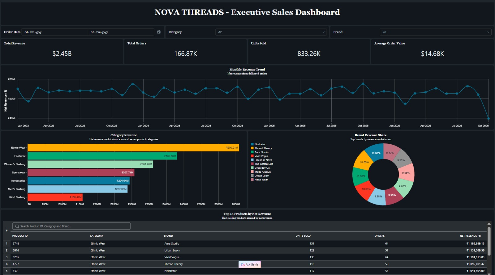
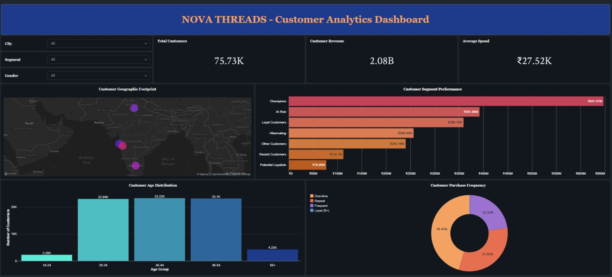
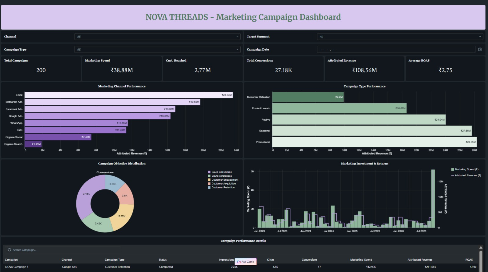

# Fashion Retail Analytics Lakehouse

An end-to-end retail analytics project built using **Databricks, PySpark, Delta Lake and SQL**, based on a fictional Indian fashion retailer called NOVA THREADS.

The project explores how data from different areas of a retail business can be brought together, cleaned, transformed and analysed to understand business performance. It covers the complete journey from generating synthetic datasets and building a lakehouse architecture to writing analytical SQL queries and developing interactive dashboards.

---

## Table of Contents

1. [Project Overview](#1-project-overview)
2. [Technology Stack](#2-technology-stack)
3. [Data Generation](#3-data-generation)
4. [Lakehouse Implementation](#4-lakehouse-implementation)
5. [SQL Analytics](#5-sql-analytics)
6. [Interactive Dashboards](#6-interactive-dashboards)
7. [Key Results](#7-key-results)
8. [Repository Structure](#8-repository-structure)
9. [What I Learned](#9-what-i-learned)
10. [Project Information](#10-project-information)

---

## 1. Project Overview

NOVA THREADS is a fictional Indian fashion retailer operating through a website and mobile application across Mumbai, Pune, Delhi and Bengaluru.

As the business grows, its operations generate data across several areas, including customer registrations, product catalogues, orders, warehouse inventory and marketing campaigns. Although each dataset provides information about a particular business function, analysing them together makes it possible to understand overall performance and identify patterns that might otherwise go unnoticed.

The aim of this project was to simulate this retail environment and build an end-to-end analytics solution using Databricks. Starting with programmatically generated synthetic data, I developed a lakehouse workflow to clean, transform and analyse the datasets before presenting the results through interactive dashboards.

The project explores five key areas of retail analytics:

- **Sales Performance:** Revenue trends, order volumes and average order value.
- **Product Analytics:** Category, brand and product-level revenue contribution.
- **Customer Analytics:** RFM segmentation, customer value and repeat purchasing behaviour.
- **Inventory Analytics:** Warehouse stock levels and replenishment requirements.
- **Marketing Analytics:** Campaign performance, channel efficiency and return on ad spend.

The final solution brings together approximately **850,000 synthetic records**, a three-layer lakehouse architecture, 10 analytical SQL queries and three interactive dashboards.

## 2. Technology Stack

| Technology | How it was used |
|---|---|
| Databricks | Development environment for the lakehouse and analytics |
| Python | Programmatic generation of synthetic retail data |
| PySpark | Data transformations, cleaning and aggregations |
| Delta Lake | Storage of structured datasets across lakehouse layers |
| SQL | Business analysis and analytical queries |
| Databricks AI/BI | Interactive dashboards and visual reporting |
| GitHub | Project version control and documentation |

## 3. Data Generation

Instead of relying on an existing retail dataset, I generated the data programmatically using Python and PySpark. This made it possible to control the structure, relationships and distributions of the data while simulating different aspects of a fashion retail business.

The six datasets cover the following areas:

| Dataset | Records | Description |
|---|---:|---|
| Customers | 100,000 | Customer profiles, demographics and acquisition details |
| Products | 10,000 | Product categories, brands, sizes, colours and prices |
| Inventory | 40,000 | Product stock levels across four warehouses |
| Orders | 200,000 | Order dates, channels, payment methods and transaction details |
| Order Items | 499,765 | Individual products and quantities within each order |
| Marketing Campaigns | 200 | Campaign budgets, spending, impressions and performance metrics |
| **Total** | **849,965** | |

The generated data includes different customer profiles, product attributes, transaction patterns, order statuses and marketing metrics. Guest checkout is also represented, allowing the analysis to account for orders that are not associated with registered customers.

All business entities and figures are fictional and intended for analytical practice.

## 4. Lakehouse Implementation

The data is organised using the Medallion Architecture, with separate Bronze, Silver and Gold layers. Each layer has a specific purpose, allowing raw datasets to be progressively transformed into reliable, business-ready information.

### Bronze Layer – Raw Data Storage

The Bronze layer is where the six generated datasets were first stored in Databricks.

Separate notebooks were created for data generation and ingestion, with the datasets organised as managed Delta tables under the `fashion_bronze` schema.

At this stage, the focus was on preserving the generated data in a structured format so that subsequent transformations could be performed independently.

The result was six Bronze tables containing 849,965 records across customers, products, inventory, orders, order items and marketing campaigns.

### Silver Layer – Data Cleaning and Transformation

The Silver layer focuses on making the raw datasets consistent and suitable for analysis.

I developed separate PySpark notebooks for each dataset, covering standardisation, data validation and business-rule checks.

Some of the transformations included:
- Standardising text fields, categorical values, dates and identifiers.
- Validating customer ages, email formats and registration dates.
- Checking product prices and inventory stock levels.
- Reconciling order amounts and validating transaction details.
- Verifying order-item calculations, including gross amounts, discounts and net values.
- Checking marketing campaign metrics, including impressions, clicks, conversions and calculated KPIs.

I also accounted for legitimate business scenarios rather than treating every exception as bad data. For example, guest orders were retained even when customer IDs were missing, and repeated order-product combinations were preserved when they represented separate line items.

After the transformations, all six Silver datasets were saved as managed Delta tables. The implemented validation checks reported zero invalid records across the tested business rules.

### Gold Layer – Business-Ready Analytics

With the data cleaned and validated, the Gold layer brings it together into datasets designed around specific business requirements.

Rather than repeatedly querying raw transactional data, I created aggregated and analytical tables that could be reused across SQL queries and dashboards.

| Business Area | Analytical Tables | What they cover |
|---|---|---|
| Sales | `daily_sales_performance` | Daily revenue, orders, discounts and units sold |
| Products | `category_performance`, `brand_performance`, `product_performance` | Revenue and sales performance at category, brand and product levels |
| Customers | `customer_analytics`, `customer_segment_summary` | Customer purchasing behaviour, RFM scores and segment-level metrics |
| Inventory | `inventory_analytics`, `inventory_replenishment` | Warehouse stock health and products requiring replenishment |
| Marketing | `campaign_performance`, `campaign_channel_performance`, `campaign_type_performance`, `campaign_objective_performance`, `campaign_segment_performance`, `campaign_overview` | Campaign results across channels, campaign types, objectives and target segments |

The customer analytics workflow also includes RFM segmentation, using recency, frequency and monetary value to group customers into categories such as Champions, Loyal Customers, At Risk and Hibernating.

The resulting Gold tables provide a consistent foundation for the SQL analysis and dashboards developed later in the project.

## 5. SQL Analytics

Once the Gold tables were ready, I moved to Databricks SQL to explore the business questions in more detail.

I developed 10 individual queries, each focusing on a different area of retail performance. These queries go beyond basic aggregations and use CTEs, window functions, ranking, date calculations and conditional logic.

| No. | Analysis | What it explores |
|---:|---|---|
| 01 | Daily Sales Performance | Examines daily revenue, order volumes and units sold to understand overall sales activity. |
| 02 | Top Performing Products | Ranks products by net revenue to identify the highest-contributing products and compare their sales volumes. |
| 03 | Monthly Sales Trends | Compares monthly revenue using `LAG()`, month-over-month growth and rolling three-month averages to identify changes in sales trends. |
| 04 | Category Revenue Analysis | Compares category revenue, order volumes and revenue contribution to understand which product categories drive sales. |
| 05 | Customer Segment Analysis | Evaluates customer segments using recency, frequency and monetary metrics to identify high-value and inactive groups. |
| 06 | Customer Cohort Retention | Groups customers by their first purchase month and tracks subsequent monthly purchasing activity to understand retention patterns. |
| 07 | Repeat Purchase Analysis | Groups customers into one-time, repeat, frequent and loyal purchasing segments and compares their contribution to revenue. |
| 08 | Discount Analysis | Examines gross revenue, discount amounts and net revenue across different discount bands to understand discount distribution. |
| 09 | Inventory Replenishment Analysis | Identifies low-stock and out-of-stock products across warehouses and evaluates recommended replenishment quantities. |
| 10 | Marketing Channel ROI Analysis | Compares marketing channels using blended ROAS, click-through rates, conversions and cost per conversion. |

### SQL concepts used

- CTEs for breaking complex queries into manageable steps.
- Window functions such as `LAG()`, `RANK()` and `NTILE()`.
- Rolling averages and month-over-month comparisons.
- Cohort-based retention calculations.
- Conditional aggregations using `CASE WHEN`.
- Revenue contribution, percentage calculations and analytical rankings.

Together, these queries provide a deeper look at the data behind the dashboards and demonstrate how SQL can be used to answer practical business questions.

## 6. Interactive Dashboards

The final stage of the project was to turn the analytical datasets into interactive dashboards using Databricks AI/BI.

I built three separate dashboards, each with its own layout and visual style based on the business area it covers. They combine KPI cards, charts, tables, tooltips and interactive filters so that users can explore the results rather than just view static reports.

### 6.1 Executive Sales Dashboard

**Purpose:** Give a quick overview of sales performance while allowing users to explore the products, categories and brands contributing to revenue.

The dashboard starts with four key metrics: total revenue, total orders, units sold and average order value. These provide an immediate view of overall business performance.

Below the KPIs, the monthly revenue trend helps identify changes in sales over time. Category revenue and brand revenue share provide a comparison of the different product groups and brands, while the Top 10 Products table highlights the products generating the highest net revenue.

**Interactive filters:** Order Date, Category and Brand.

**What it helps answer:** How is the business performing, which categories and brands contribute most to revenue, and which individual products are the strongest performers?

**Dashboard Preview**

### 6.2 Customer Analytics Dashboard

**Purpose:** Understand who the purchasing customers are, where they are located and how their purchasing behaviour differs.

The dashboard brings together customer and revenue KPIs with a geographic view of customer distribution across Mumbai, Pune, Delhi and Bengaluru.

The customer segment performance chart compares revenue across the seven RFM-based segments, making it easier to identify groups that contribute significantly to customer revenue.

The age distribution chart provides a demographic breakdown, while the repeat purchase donut chart shows how customers are distributed across one-time, repeat, frequent and loyal purchasing groups.

**Interactive filters:** City, Gender and Customer Segment.

**What it helps answer:** Which customer segments are most valuable, where are purchasing customers concentrated, and how does purchasing frequency differ across the customer base?

**Dashboard Preview**

### 6.3 Marketing Campaign Dashboard

**Purpose:** Examine how marketing campaigns perform across different channels, campaign types, objectives and target customer segments.

The dashboard begins with six KPIs covering total campaigns, marketing spend, customers reached, conversions, attributed revenue and average ROAS.

The Marketing Channel Performance chart compares attributed revenue across channels such as Email, Instagram Ads, Facebook Ads, Google Ads and WhatsApp.

Campaign Type Performance provides a comparison of promotional, seasonal, festive and other campaign types. The Campaign Objective Distribution donut chart shows how conversions are distributed across marketing objectives.

A monthly investment and returns combination chart compares campaign spend with attributed revenue, while the campaign details table allows individual campaigns to be examined using their spend, impressions, clicks, conversions and ROAS.

**Interactive filters:** Marketing Channel, Campaign Type, Target Segment and Campaign Start Month.

**What it helps answer:** Which channels and campaign types perform better, how marketing investment compares with attributed revenue, and which individual campaigns stand out?

**Dashboard Preview**

*Note: Marketing attributed revenue is synthetic campaign-reported data and is not reconciled against actual order transactions. The monthly investment and returns chart groups campaigns by their start month rather than tracking revenue recognition by transaction date.*

## 7. Key Results

The generated dataset produced the following illustrative business metrics:

| Metric | Result |
|---|---:|
| Total Orders | 200,000 |
| Delivered Orders | 166,872 |
| Delivered Order Revenue | ₹244.94 Crore |
| Average Order Value | ₹14,676.50 |
| Registered Purchasing Customers | 75,733 |
| Total Marketing Campaigns | 200 |
| Campaign Attributed Revenue | ₹10.86 Crore |
| Average Campaign ROAS | 2.75x |

These figures demonstrate how the different datasets can be transformed into useful business metrics, from tracking revenue and product performance to understanding customer value and marketing efficiency.

## 8. What I Learned

Building this project gave me practical experience working with Databricks beyond writing individual SQL queries.

I worked through the process of generating datasets, organising them into a lakehouse architecture, transforming data using PySpark and Delta tables, and validating the results before using them for analysis.

It also gave me an opportunity to apply SQL concepts to actual business questions, particularly around customer segmentation, cohort retention, repeat purchasing, inventory planning and marketing performance.

Finally, building the dashboards helped me think about how analytical results should be presented to different stakeholders, rather than simply producing tables of numbers.

## 9. Project Information

**Project:** Fashion Retail Analytics Lakehouse  
**Business:** NOVA THREADS (Fictional)  
**Platform:** Databricks Free Edition  
**Architecture:** Bronze-Silver-Gold (Medallion Architecture)  
**Author:** Yash Dubey

*All customers, products, transactions, campaigns and business metrics are synthetically generated for learning and portfolio demonstration. They do not represent actual company data.*
